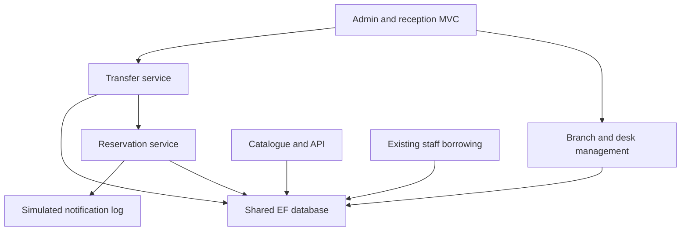

# Azd R2 and R4 implementation

The supplied Group 11 plan assigns Azd the secure read-only API (R2) and branch inventory/transfers (R4). Asraful reviews R2; Safiyan reviews R4. This implementation preserves the Assignment 2 item inheritance model and the merged R3/R5 reservation and notification services.

## Shared data contract

- Each Item is one physical copy, uniquely identified by LibraryCode. Book, Music and Toy use the existing Items table and discriminator.
- Item.BranchId is nullable for legacy or newly entered stock. An administrator assigns available unassigned stock once; use transfers for later moves. Unassigned copies are omitted from API available stock.
- Each ReceptionDesk has a globally unique code and a required physical BranchId. Admin manages desks and may deactivate them.
- Branch codes are unique and normalised to uppercase. Admin creates/edits branches. Deactivation is blocked while stock, active desks or unfinished transfers reference the branch. Records are retained for history instead of being deleted.
- ItemTransfer records source, destination, dispatched/received state, UTC timestamps and the signed-in staff identity. Reception and Admin may dispatch/receive. Source and destination must be distinct active branches.
- Dispatch accepts only available assigned stock with no active loan, hold or dispatched transfer. It sets InTransit atomically with the audit row. BranchId remains the source until receipt; neither branch lists it as available.
- Receipt checks the selected receiving branch, active destination, source and state. It atomically changes BranchId, releases InTransit, completes the audit and runs the existing reservation service. Duplicate or wrong-branch receipts fail.
- Serializable transactions protect the transfer checks. Status and BranchId are EF concurrency tokens, so a stale borrow/edit cannot overwrite a transfer. A filtered unique index permits only one dispatched transfer per copy. Foreign keys restrict history deletion.
- The three existing item editors reject manually setting or overwriting InTransit. Existing borrowing accepts only Available/Reserved, so transit stock cannot be borrowed. Reservation allocation now only promotes Available/Reserved stock; it cannot change transit, borrowed or damaged stock to Reserved. A hold placed while a copy travels waits until receipt.

## API contract

All routes require HTTPS and a privately configured `CatalogueApi:Key` (minimum 32 characters), supplied in `X-Api-Key`. A dedicated authentication scheme uses a fixed-time hash comparison. It fails closed when unconfigured and returns HTTP 401 without an Identity login redirect. HTML staff pages retain normal Identity redirects. Responses set `Cache-Control: no-store`.

| GET route | Response |
| --- | --- |
| `/api/catalogue/items` | `{ page, pageSize, total, items }`; only available stock at active assigned branches with no open loan, hold or transfer |
| `/api/catalogue/items?branchId=1&page=1&pageSize=50` | Same response filtered by branch; pageSize 1–100, page 1–1000000, positive optional branchId |
| `/api/catalogue/categories` | `["Book", "Music", "Toy"]`, matching the baseline item types |
| `/api/catalogue/status` | Operating/Maintenance, UTC timestamp and public branch IDs, codes, names, active flags and opening-hours text |

Item responses contain only Id, LibraryCode, Name, Description, Category, Status, BranchId, BranchCode and BranchName. They never serialize entity navigation graphs or expose patrons, loans, fine details, credentials or staff audit fields. Branch opening-hours text does not claim a real-time open/closed calculation. POST/PUT/PATCH/DELETE on these routes return 405 and cannot change catalogue records. Invalid filters return 400. No CORS access is added.

PowerShell examples after starting the app (use the actual HTTPS URL and your session's private `$apiKey`):

```powershell
$base = "https://localhost:YOUR_HTTPS_PORT"
Invoke-RestMethod "$base/api/catalogue/items" -Headers @{ "X-Api-Key" = $apiKey }
Invoke-RestMethod "$base/api/catalogue/categories" -Headers @{ "X-Api-Key" = $apiKey }
Invoke-RestMethod "$base/api/catalogue/status" -Headers @{ "X-Api-Key" = $apiKey }
# Expected 401:
Invoke-WebRequest "$base/api/catalogue/items"
# Expected 405:
Invoke-WebRequest "$base/api/catalogue/items" -Method Post -Headers @{ "X-Api-Key" = $apiKey }
```

PowerShell throws for expected 401/405 responses; capture the HTTP status without exposing the key. Use the trusted development HTTPS certificate; do not disable certificate validation.

## R4 demonstration

1. Enable the optional branch demo seed, run database update, start and login as Admin.
2. Open Branches and Reception desks; verify the three explicitly marked demo locations and desk relationships. Create a branch/desk and try duplicate codes or missing required fields.
3. Open Branch stock and transfers. Filter Darwin (Demo); note `DEMO-DAR-BOOK` is available at Darwin. Repeat the view with Casuarina.
4. Dispatch that copy from Darwin to Casuarina. The audit shows Dispatched and the copy shows In transit. It is absent from the API available stock at both locations; borrowing is refused.
5. Try receipt at Darwin: it is refused. Select Casuarina and confirm receipt. It appears there as Available, unless the reservation queue legitimately makes it Reserved.
6. Refresh/resubmit receipt: the service refuses duplicate completion. The item count stays one and history retains both staff identities and times.
7. Repeat with Reception access. A Manager/anonymous user cannot manage transfers; Reception cannot manage branches/desks or assign unassigned stock.

## Integration overview



The public catalogue now displays each copy's branch and written transit state. Safiyan's services remain the queue/notification owners; only the availability guard and receipt integration needed for R4 were changed. Malia's merged importer now accepts optional BranchCode, validates an active branch in preview and again in the serializable confirmation transaction, and writes BranchId for valid new rows. Existing CSV files without the column remain supported. Asraful's kiosk must accept only Available/eligible Reserved stock and respect EF concurrency failures; it must not overwrite transit status.

## Scope and review

This branch preserves the teammates' merged kiosk, importer and reporting modules, or fabricate board issues, hours, meetings, peer approvals or VM evidence. Final merging remains subject to review and a successful database/VM check. Implementation and test preparation in this session used ChatGPT/Codex assistance; review and understand the code and follow the unit's disclosure rules.
